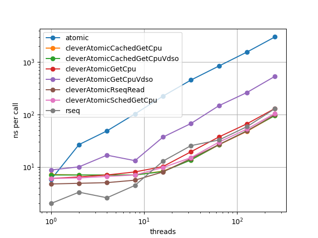

# Introduction

A mutex that uses restartable sequences in Linux to attempt to lock access to a given cpu.
This has the benefit that it has no atomics. The downside is that it only supports algorithms that do not need global 
mutual exclusion.

Note you cannot actually guarantee that you can lock this mutex. 
The lock may fail if it was taken by some sleeping or rescheduled thread, even though you are now running on that cpu.
In general I expect the critical section to be short, so we optimistically assume you will not be rescheduled while inside the critical section, 
and thus generally the lock will succeed. 

# API

`int rseq_mutex_static_init()`
Attempts to init the library. Return non-zero on fail. Will fail if running on too old a glibc or kernel. 
Undefined behaviour for the rest of the API on failure.

`int rseq_mutex_init(struct rseq_mutex** mutex);`
`struct rseq_mutex* rseq_mutex_create();`
`void rseq_mutex_free(struct rseq_mutex* mutex);`

Create and free a mutex.

`int rseq_mutex_try_lock(struct rseq_mutex* mutex)` 
Try and lock a mutex. Returns the cpu id that you have locked, which is the one the thread is scheduled on.
If returns < 0, then the lock was unsuccesful.

`rseq_mutex_release(struct rseq_mutex* mutex, int cpu);`
Release the lock.

`rseq_mutex_spin_lock_cpu(struct rseq_mutex* mutex, int cpu)`
Try and lock a given cpu (ie not specifically the current one).
This will spin until the target cpu is available.

`rseq_mutex_spin_unlock_cpu(struct rseq_mutex* mutex, int cpu)`
Unlock a cpu after having called `rseq_mutex_spin_lock_cpu`.i

# Benchmark

A simple benchmark is to test the performance of incrementing shared counters. An example use case for this 
is performance metrics.
For comparison I copied some algorithms used by 
[Facebook's Folly library](https://github.com/facebook/folly/blob/main/folly/concurrency/CacheLocality.h).

The other locks used are:
 * Single shared atomic counter: expected to be slow
 * A range of more clever shared atomics, where the cleverness is to spread them out over multiple cache lines.
   The problem here is how to figure out what cpu you are on, to know which atomic to use. So a range is tried:
   * GetCpu - use the getcpu system call
   * GetCpuVdso - use [the approach](https://github.com/facebook/folly/blob/9e54a45ed40abd094528da68e3c36b6c0d4574ec/folly/concurrency/CacheLocality.cpp#L347) taken by Folly to use the VDSO version of GetCpu
   * SchedGetCpu - use the sched_getcpu system call
   * CachedGetCpu(*) - assume threads are scheduled on the same cpu and cache the cpu for a number (1000) of cycles 

As can be seen this lock is pretty performant, and seems to be better than all for lower thread counts.


Charts were generated on Linux 6.5.8 on a i7-1360P.

# Shared pointer example

[examples/percpu_shared_ptr.h](examples/percpu_shared_ptr.h) provides
`percpu_shared_ptr_factory<TCounter = int>`, a move-only
`percpu_shared_owner<T, TCounter = int>`, and copyable counted handles
`percpu_shared_ptr<T, TCounter = int>` (also named `percpu_weak_ptr`). Every
object has a main owner. It uses only public `rseq_mutex` APIs and C++17.

```cpp
#include "percpu_shared_ptr.h"

percpu_shared_ptr_factory<> factory(std::nullopt); // manual collection
// Omit the argument to collect every minute, or supply a positive duration.
auto owner = factory.make<int>(42);
auto reference = owner.weak();
owner.kill();                    // also automatic on owner destruction
factory.collect();              // fold one CPU at a time into the atomic
auto copy = reference;          // counted handles keep the object alive
reference.reset();
copy.reset();
factory.collect();              // delete at atomic zero; no further CPU locks
```

Here “weak” means a counted handle subordinate to the main owner. It keeps the
object alive after `kill()`, permits dereferencing and copying, and needs no
`lock()` operation. Kill is idempotent and drops the owner's initial reference
exactly once. Moving an owner transfers responsibility for killing; move
assignment kills the previous object.

A slab has one counter line per CPU, with spacing and alignment from
`std::hardware_destructive_interference_size`. Each line packs
`cache_line_size / sizeof(TCounter)` signed counters, one per object slot.
The counter storage must be lock-free and occupy `sizeof(TCounter)` bytes. Compile
all consumers with consistent compiler/target options because the standard
library's interference size determines the layout. The rseq mutex has its own
separate CPU padding.

The factory keeps intrusive lists of slabs and slabs with free slots. Slots
have a slab back-pointer and counter index, with embedded links moving between
free, active, pending, and retired lists. Partially occupied slabs supply free
slots; empty slabs are freed after their last object's destructor finishes.
`factory.slab_count()` reports the current slab allocation.

`make()` constructs objects and allocates/initializes slabs outside the metadata
lock. A private helper reserves and links a slot while pinning its slab.
`slot::init()` initializes its fields outside the lock, then release-stores the
`active` state. The collector acquire-loads state and skips `dead` reservations,
so initialization needs no second lock or list-publication step. Slab
back-pointers are stored in `slot::owner`.

Copy/release attempts the local rseq lock, reads the slot state inside that lock,
and updates the local signed counter with loads/stores. If the core lock is
busy, the CPU ID is unsupported, or the object has been killed, it uses the
signed atomic fallback. When a local update reaches either half-range boundary,
it adds the entire signed local count (including that update) to the fallback
atomic and resets the local counter to zero while holding the core lock. For
int8_t, the boundaries are +64 and -64. Later operations resume local counting. Moves do not change
counts. Reference increments and decrements can occur on different CPUs, so local
counts may be negative. Each slot has an atomic `dead`, `active`, or `dying` state on its own cache
line. `kill()` stores `dying`; reclaimed slots return to `dead`.

Kill coalesces a factory notification before releasing the owner's initial
reference. Notification uses a release RMW so concurrent kills form a release
sequence consumed by the collector. Collection scans slot states only when a
notification is pending, without core locking. Killed objects are queued
and folded in the same collect() call. Folding acquires and releases **one CPU lock at
a time** for the entire pending batch. Under that lock it reads and zeros each
local counter into per-slot scratch storage; after unlocking it adds those deltas
to the fallback atomics. A pass locks each CPU once,
regardless of the number of pending slots or slabs.
The permanent dying state, checked under the update lock, prevents future local
writes on a drained CPU. Atomic updates can continue during folding. Zero is
checked only after every CPU has been drained. A failed lock leaves the
candidate queued, and retrying safely revisits already-zeroed counters. Once
folded, they move to a separate intrusive dying list. Later collection checks
only that list and never locks cores again for those objects. A relaxed load
filters nonzero counts; an acquire/release RMW confirms a possible zero before
destruction. Thus waiting for remaining references does not repeatedly modify
their shared atomic cache line or rescan the live pool.

Signed deltas are summed modulo 2^64, including defined wrapping of the signed
atomic. The number of live handles cannot reach 2^64 in the supported 64-bit
address space. Destructors run outside the metadata and core locks and may create objects or
release handles. A collection mutex serializes complete cycles through all
object destruction, including worker and manual calls. Destructors must not
call collect() recursively on the same factory. Retired slots pin slabs until
destruction finishes, while make() and handle operations can continue.

The interval is an `std::optional<std::chrono::milliseconds>` defaulting to one
minute. `std::nullopt` disables the worker. A supplied duration must be strictly
positive; zero and negative durations throw `std::invalid_argument`. Each
Manual `collect()` folds newly observed dying objects and returns the number
destroyed. Objects with remaining counted handles stay alive in atomic mode. Shutdown joins the worker and drains pending work
without waiting for the timer, including objects killed by other destructors.

The **factory must outlive all owners and counted handles**. No external factory
operation may race shutdown. Destroying a factory with remaining references or
cycles terminates the process. Separate handles may be used concurrently;
mutating the same handle or pointee requires external synchronization. The
example does not provide std::weak_ptr semantics, aliasing/converting
constructors, custom deleters, arrays, enable_shared_from_this, or use_count.

```sh
make
./examples/shared_ptr.example
make -C tests check-shared-ptr
```

Tests cover owner lifecycle, immediate folding of killed objects, kill racing with copies,
signed-counter half-range flushing and folding, atomic fallback, slab reclamation,
concurrent destructors, scheduled/manual collection, and invalid intervals.
Public lock functions are wrapped to verify that folding never holds two core
locks and that an interrupted fold retries without losing a candidate or count.

## Shared pointer benchmarks

```sh
# max threads, iterations/thread, repeats, collection interval in minutes
./benchmarks/shared_ptr.bench 16 5000000 3 1 > /tmp/shared-ptr.csv
# CLI zero selects nullopt (manual collection), rather than a zero duration:
./benchmarks/shared_ptr.bench 16 5000000 3 0 > /tmp/shared-ptr-manual.csv
```

The benchmark compares std::shared_ptr with mandatory-owner percpu pointers
using int16_t, int, and int64_t counters. Roots retain main owners; worker copies
carry counted handles. Workers are pinned identically for all implementations.
Thread counts are powers of two plus the requested maximum.

| Workload | Operation |
| --- | --- |
| copy_shared | Copy/release a handle to one shared object. |
| copy_distinct | Copy/release a handle to a separate object per thread. |
| copy_killed | Copy/release after kill and folding, performed before timing. |
| churn | Create/release an owner and handle, including final destruction, slab frees, and shutdown. |

CSV ns_per_op is wall time divided by total operations, not individual latency.
Worker creation/join and initial root allocation are outside timed copy loops.
A compiler escape retains copy/release operations, and workers check checksums.
Final drain_ns is reported separately and included in churn's ns_per_op. Churn
is capped at 2,000 iterations per thread. Implementations rotate execution order
between repeats; each row uses a fresh factory. Short runs finish before the
minute timer fires, so measuring periodic collection requires longer runs.

### Many readers, one object killed at a time

```sh
./benchmarks/shared_ptr_single_kill.bench 32 256 128 1000 3 > /tmp/single-kill.csv
# Arguments: max workers, initial objects, kills, pause between kills (us), repeats
```

Workers start with their own counted handles to every object in a shared pool.
Each touch randomly selects a surviving object, copies its handle, reads its
value, and releases the copy. Workers check retirement requests every 64 touches
and drop their persistent handles to retired objects. The killer kills one main
owner, explicitly collects, and waits for that object's destructor before
requesting the next kill. Objects are not replaced, so this command gradually
shrinks the live pool from 256 to 128. The standard shared-pointer baseline drops
its root and waits for the same worker-handle drain.

The killer has a dedicated allowed CPU. Workers share the other allowed CPUs
round-robin; larger worker counts oversubscribe those CPUs. Initial allocation,
handle distribution, and final survivor cleanup are outside timing. The
one-minute factory worker is disabled with nullopt; the killer collects
explicitly. Measurements cover the kill interval and workers finishing their
current batch after the stop request, with thread joining outside timing.

CSV reports aggregate worker Mops/s and ns/op, plus p50/p95/max end-to-end kill
latency in microseconds. Kill latency includes draining all worker handles and
collection, rather than just the kill() call. The pause is applied before each
kill, so slower retirement extends the run instead of building a backlog.
`collection_calls` counts calls to the store's collect adapter (a no-op for the
standard baseline). Checksums, destructor flags, per-worker progress, and final
cleanup are checked in every run. Use medians across repeats.
